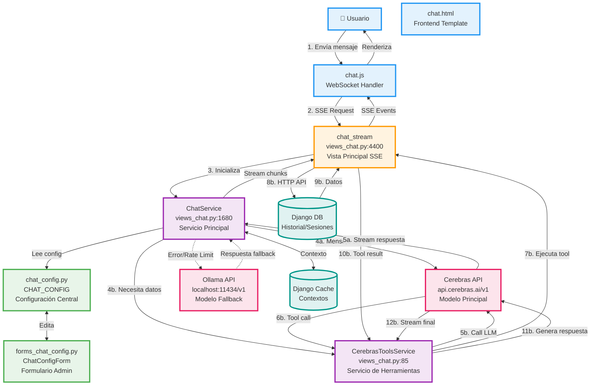
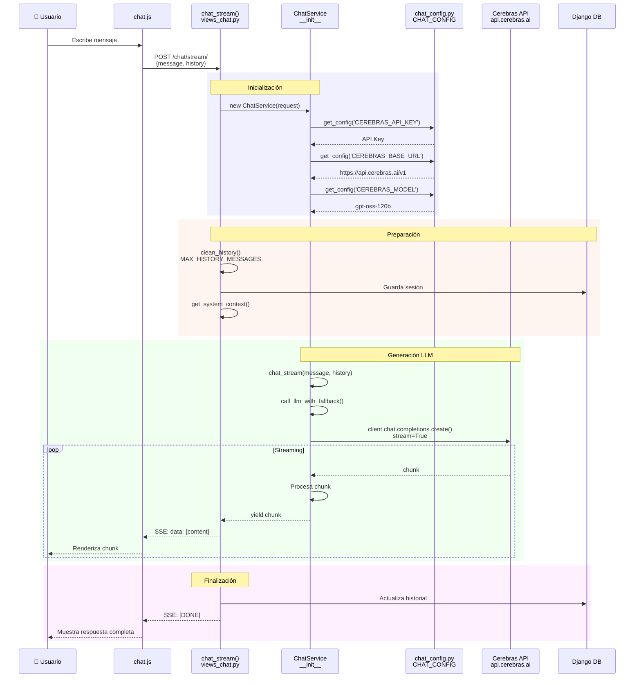
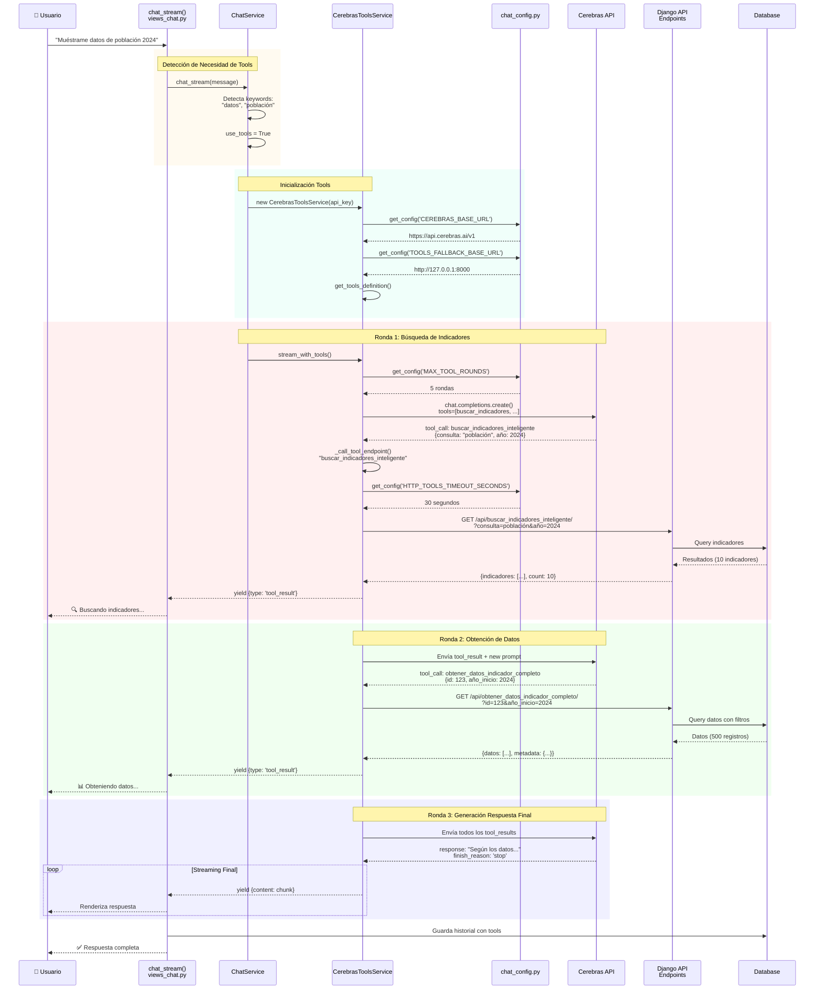
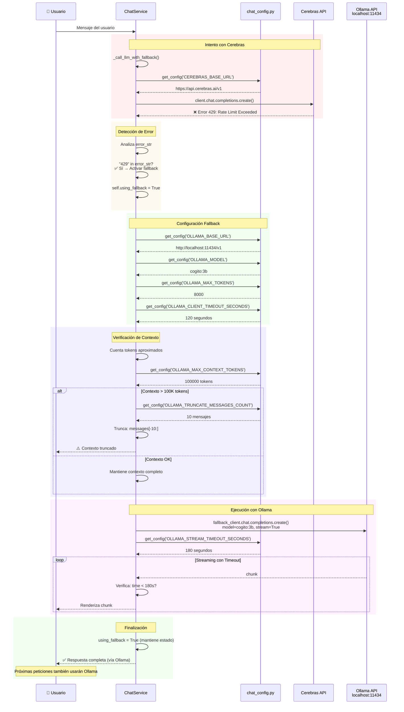
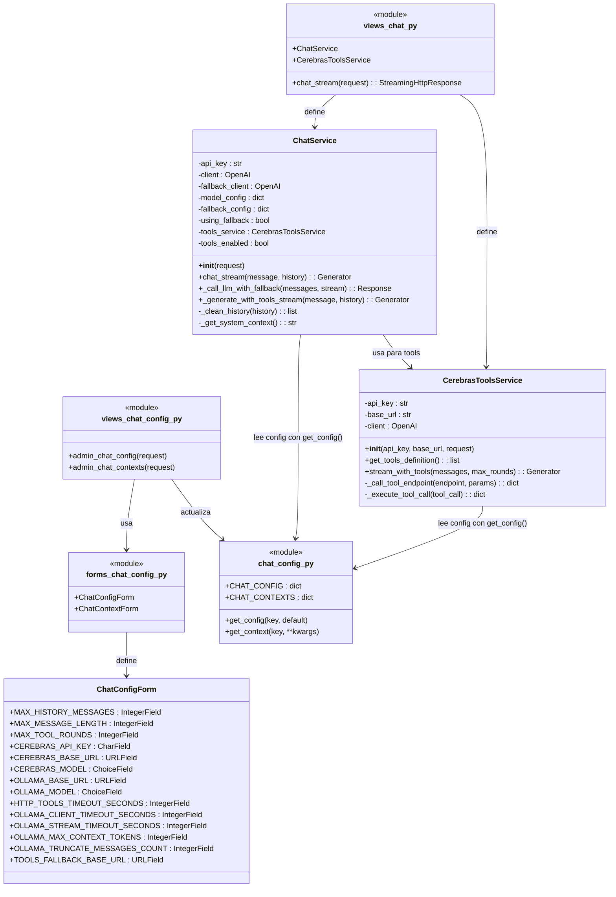
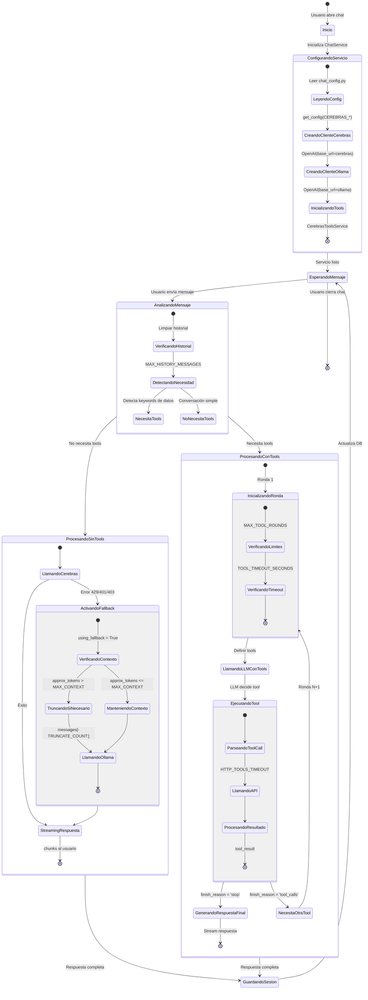
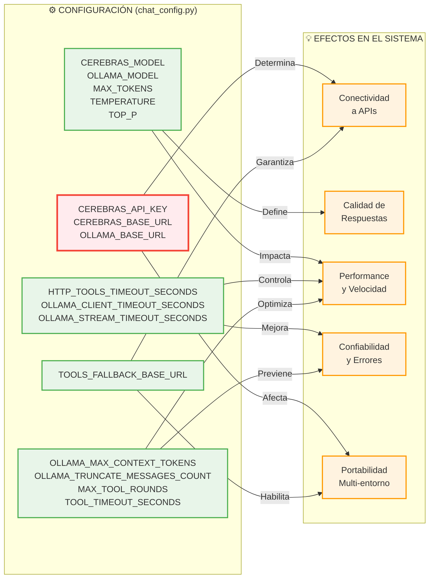

# 🔄 DIAGRAMA DE FLUJO DEL SISTEMA DE CHAT

## 📊 Diagrama Principal: Arquitectura Completa

---

## 🔀 Diagrama: Flujo de Conversación Normal (Sin Herramientas)

---

## 🛠️ Diagrama: Flujo con Herramientas (Tools)

---

## ⚡ Diagrama: Flujo de Fallback (Cerebras → Ollama)

---

## 📁 Diagrama: Estructura de Archivos y Clases

---

## 🔄 Diagrama: Ciclo de Vida de una Sesión de Chat

---

## 🎯 Diagrama: Puntos de Configuración y sus Efectos

---

## 📈 Métricas del Sistema

### Configuraciones Totales: **24 parámetros**

| Categoría | Parámetros | Criticidad |
|-----------|------------|------------|
| **APIs y Conexiones** | 4 | 🔴 Alta |
| **Modelos IA** | 8 | 🟡 Media |
| **Timeouts** | 4 | 🔴 Alta |
| **Límites y Control** | 6 | 🟡 Media |
| **Caché y Performance** | 2 | 🟢 Baja |

### Archivos Principales: **4**
- `views_chat.py` (4,559 líneas)
- `chat_config.py` (314 líneas)
- `forms_chat_config.py` (236 líneas)
- `views_chat_config.py` (Admin handlers)

### Clases Clave: **2**
- `ChatService` (Principal)
- `CerebrasToolsService` (Herramientas)

### Flujos de Datos: **3**
1. Conversación Normal (Sin Tools)
2. Conversación con Herramientas (Tools)
3. Fallback Automático (Cerebras → Ollama)

---

**Generado:** 2025-10-19  
**Versión:** 1.0  
**Formato:** Mermaid Diagrams
