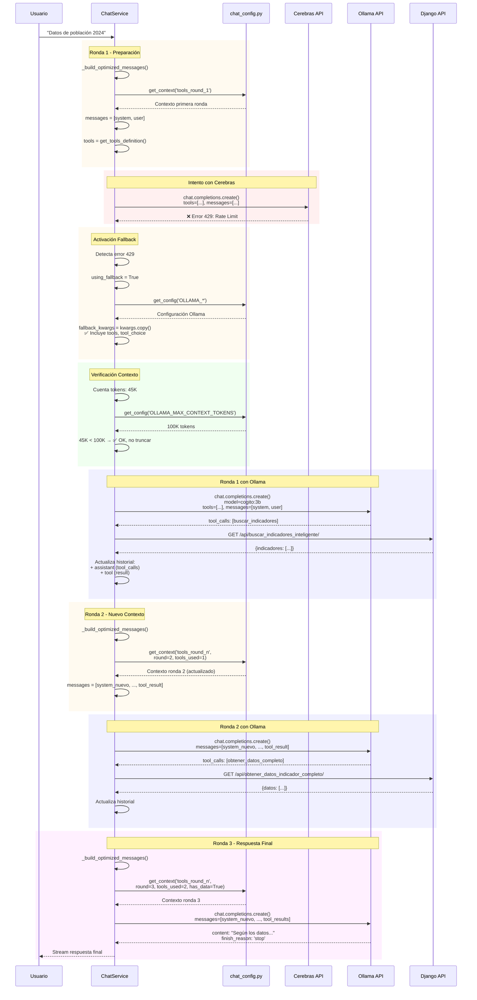

# 🔄 FALLBACK A OLLAMA CON TOOLS: Análisis Completo

## 🎯 Pregunta Clave

**¿Qué sucede cuando se activa el fallback a Ollama mientras se están usando herramientas (tools)?**

---

## ✅ RESPUESTA CORTA

**Ollama SÍ soporta tools completamente** con el modelo Cogito. Cuando se activa el fallback:

1. ✅ **Se mantienen las tools** en la petición
2. ✅ **Se mantienen los contextos** (tools_round_1, tools_round_n)
3. ✅ **Se mantiene el historial completo** (con tool_calls y tool_results)
4. ⚠️ **Se trunca el contexto** si supera 100K tokens (configurable)
5. ✅ **El flujo continúa normalmente** como si fuera Cerebras

---

## 📊 FLUJO DETALLADO: Fallback con Tools Activos

### **Escenario:**
```
Usuario: "Muéstrame datos de población 2024"
↓
Ronda 1: Cerebras intenta buscar indicadores
↓
❌ Error 429: Rate Limit Exceeded
↓
🔄 Fallback activado
↓
¿Qué sucede con los tools y contextos?
```

---

## 🔍 ANÁLISIS PASO A PASO

### **Paso 1: Detección del Error (Línea 1762-1765)**

```python
# views_chat.py:1762
if should_fallback:
    logger.warning(f"⚠️ Cerebras API error ({error_str[:100]}...)")
    logger.info(f"🔄 Cambiando a Ollama local ({self.fallback_config['model']}) como fallback...")
    self.using_fallback = True
```

**Errores que activan fallback:**
- `429` - Rate Limit
- `401` - API Key inválida
- `403` - Sin permisos
- Keywords: "rate", "quota", "unauthorized", "wrong api key"

---

### **Paso 2: Preparación de Parámetros para Ollama (Línea 1767-1776)**

```python
# views_chat.py:1767-1776
# Ajustar kwargs para Ollama usando configuración
fallback_kwargs = kwargs.copy()
fallback_kwargs['model'] = self.fallback_config['model']  # cogito:3b
fallback_kwargs['max_tokens'] = self.fallback_config['max_tokens']  # 8000
fallback_kwargs['temperature'] = self.fallback_config['temperature']  # 0.2
fallback_kwargs['top_p'] = self.fallback_config['top_p']  # 0.9

# ✅ CRÍTICO: Ollama SÍ soporta tools con cogito (mantener tools y tool_choice)
num_tools = len(fallback_kwargs.get('tools', []))
logger.info(f"🔧 Ollama con {num_tools} tools habilitados")
```

**🔑 Punto Clave:**
- `fallback_kwargs.copy()` **copia TODO**, incluyendo:
  - ✅ `tools` (definiciones de herramientas)
  - ✅ `tool_choice` ("auto")
  - ✅ `parallel_tool_calls` (True)
  - ✅ `messages` (historial completo con tool_calls y tool_results)

---

### **Paso 3: Verificación y Truncado de Contexto (Línea 1778-1796)**

```python
# views_chat.py:1778-1796
# Contar tokens aproximados en mensajes
total_chars = sum(len(str(m.get('content', ''))) for m in messages)
approx_tokens = total_chars // 4  # Aproximación: 1 token ≈ 4 caracteres
logger.info(f"📊 Contexto aproximado: {approx_tokens} tokens (~{total_chars} caracteres)")
logger.info(f"📋 Número de mensajes: {len(messages)}")

# Log de los roles de los mensajes para debugging
roles_summary = [m.get('role', 'unknown') for m in messages]
logger.info(f"📝 Roles de mensajes: {roles_summary}")

# Cogito soporta 128K tokens, pero limitamos según configuración
max_context = get_config('OLLAMA_MAX_CONTEXT_TOKENS', 100000)
truncate_count = get_config('OLLAMA_TRUNCATE_MESSAGES_COUNT', 10)

if approx_tokens > max_context:
    logger.warning(f"⚠️ Contexto muy grande ({approx_tokens} tokens), truncando mensajes...")
    # Mantener solo los últimos mensajes configurados
    messages = messages[-truncate_count:]  # Últimos 10 mensajes
    logger.info(f"📊 Contexto reducido a {len(messages)} mensajes")
```

**⚠️ Implicaciones del Truncado:**

Si el contexto se trunca, se pierden:
- ❌ Mensajes antiguos del historial
- ❌ Tool calls antiguos
- ❌ Tool results antiguos
- ✅ **PERO se mantiene el contexto del sistema (system message)**

**Ejemplo de truncado:**

```python
# ANTES del truncado (15 mensajes, 120K tokens)
messages = [
    {"role": "system", "content": "Eres Don Datico..."},  # Se pierde
    {"role": "user", "content": "Hola"},  # Se pierde
    {"role": "assistant", "content": "Hola!"},  # Se pierde
    {"role": "user", "content": "Datos de población"},  # Se pierde
    {"role": "assistant", "tool_calls": [...]},  # Se pierde
    {"role": "tool", "content": "{datos...}"},  # Se mantiene (últimos 10)
    {"role": "assistant", "content": "Según..."},  # Se mantiene
    {"role": "user", "content": "Y de educación?"},  # Se mantiene
    {"role": "assistant", "tool_calls": [...]},  # Se mantiene
    {"role": "tool", "content": "{datos...}"},  # Se mantiene
    # ... (últimos 10 mensajes)
]

# DESPUÉS del truncado (10 mensajes)
messages = messages[-10:]  # Solo los últimos 10
```

---

### **Paso 4: Llamada a Ollama con Tools (Línea 1798-1808)**

```python
# views_chat.py:1798-1808
try:
    logger.info(f"🚀 Enviando petición a Ollama (stream={stream})...")
    
    if stream:
        response = self.fallback_client.chat.completions.create(
            messages=messages,  # Historial (posiblemente truncado)
            stream=True,
            **fallback_kwargs  # Incluye: model, tools, tool_choice, etc.
        )
        logger.info("✅ Stream de Ollama iniciado correctamente")
        return response
```

**Parámetros enviados a Ollama:**
```python
{
    "model": "cogito:3b",
    "messages": [...],  # Historial con tool_calls y tool_results
    "tools": [  # ✅ MANTIENE las definiciones de tools
        {
            "type": "function",
            "function": {
                "name": "buscar_indicadores_inteligente",
                "description": "...",
                "parameters": {...}
            }
        },
        # ... más tools
    ],
    "tool_choice": "auto",  # ✅ MANTIENE la elección automática
    "parallel_tool_calls": True,  # ✅ MANTIENE llamadas paralelas
    "max_tokens": 8000,
    "temperature": 0.2,
    "top_p": 0.9,
    "stream": True
}
```

---

### **Paso 5: Procesamiento de Respuesta de Ollama (Línea 2413-2440)**

```python
# views_chat.py:2413-2440
# Dentro de _generate_with_tools_stream()
response = self._call_llm_with_fallback(  # Ya activó fallback
    messages=messages,
    model=get_config('CEREBRAS_MODEL', 'gpt-oss-120b'),  # Ignorado si fallback activo
    tools=tools,  # ✅ Tools disponibles
    tool_choice="auto",
    parallel_tool_calls=True,
    max_tokens=14200,
    temperature=0.2,
    top_p=0.9,
    stream=False  # No streaming para tool calls
)

# ...

message = response.choices[0].message
final_content = message.content or ""

# Log para debugging: verificar si hay tool_calls
provider = "Ollama" if self.using_fallback else "Cerebras"  # ✅ Detecta Ollama
has_tool_calls = hasattr(message, 'tool_calls') and message.tool_calls
logger.info(f"[MCP_FIX] Respuesta de {provider}: tool_calls={has_tool_calls}, content_length={len(final_content)}")
```

**Ollama puede responder de 3 formas:**

#### **Forma 1: Con Tool Calls (Normal)**
```python
response.choices[0].message = {
    "role": "assistant",
    "content": "",
    "tool_calls": [
        {
            "id": "call_abc123",
            "type": "function",
            "function": {
                "name": "buscar_indicadores_inteligente",
                "arguments": '{"consulta": "población", "año": 2024}'
            }
        }
    ]
}
```
✅ **Flujo normal:** Se ejecutan las tools, se agregan al historial, nueva ronda.

#### **Forma 2: Sin Tool Calls (Respuesta Final)**
```python
response.choices[0].message = {
    "role": "assistant",
    "content": "Según los datos del SIIED, la población de Cali en 2024 es...",
    "tool_calls": None
}
```
✅ **Respuesta final:** Se envía al usuario, fin del flujo.

#### **Forma 3: Respuesta Procesada Internamente (Ollama específico)**
```python
# Línea 2477-2487
# Si Ollama devolvió respuesta final (no tool calls) pero teníamos tools disponibles
# Simular feedback de tools para UX consistente
if not looks_like_tool and self.using_fallback and tools and len(final_content) > 200:
    logger.info("[MCP_FIX] Ollama devolvió respuesta procesada - Generando feedback simulado")
    # Enviar feedback genérico de que se consultaron herramientas
    yield {
        'content': '🔍 Consultando base de datos del SIIED...',
        'is_complete': False,
        'source': 'progress',
        'tool_name': 'ollama_internal_tools'
    }
```

⚠️ **Caso especial:** Ollama puede procesar tools internamente y devolver respuesta directa.
En este caso, se simula feedback para mantener UX consistente.

---

## 🔄 CONTEXTOS: ¿Qué Sucede con Ellos?

### **Contextos Utilizados en el Flujo con Tools**

```python
# views_chat.py:2597-2620
def _build_optimized_messages(self, history: list, session_state: dict) -> list:
    messages = []
    
    # Contexto base optimizado según la ronda
    if session_state['round'] == 1:
        system_context = get_context('tools_round_1')  # ✅ Primera ronda
    else:
        system_context = get_context(
            'tools_round_n',  # ✅ Rondas subsiguientes
            round=session_state['round'],
            max_rounds=session_state['max_tool_rounds'],
            tools_used=len(session_state['tools_used']),
            has_data=session_state['has_meaningful_data']
        )
    
    messages.append({"role": "system", "content": system_context})
    
    # Agregar historial reciente
    max_history = get_config('MAX_HISTORY_MESSAGES', 8)
    recent_history = history[-max_history:] if len(history) > max_history else history
    messages.extend(recent_history)
    
    return messages
```

### **Contextos Disponibles (chat_config.py)**

#### **1. `tools_round_1` - Primera Ronda**
```python
'tools_round_1': """Eres Don Datico, el asistente oficial del SIIED en Santiago de Cali. 🦜
Inicia cada conversación con un saludo cordial...

METODOLOGÍA DE TRABAJO (Metodología General):
1. ENTIENDE LA CONSULTA
2. NAVEGA LA ESTRUCTURA
3. BUSCA CON INTELIGENCIA
4. EXTRAE DATOS CON PRECISIÓN
5. RESPONDE CON CLARIDAD
...
"""
```

#### **2. `tools_round_n` - Rondas Subsiguientes**
```python
'tools_round_n': """Continuamos en la ronda {round} (máximo {max_rounds}) con Don Datico.

¿CÓMO VAMOS?:
- Herramientas ya usadas: {tools_used}.
- ¿Hay datos jugosos? {has_data}.

ESTRATEGIA DE BÚSQUEDA INTELIGENTE:
1. ANALIZA LA CONSULTA primero
2. USA FILTROS JERÁRQUICOS para precisión
3. EXTRAE DATOS CON FILTROS TEMPORALES
4. RESPONDE CUANDO TENGAS SUFICIENTE
...
"""
```

### **🔑 Punto Crítico: Contextos con Fallback**

**¿Se mantienen los contextos cuando se activa el fallback?**

✅ **SÍ, COMPLETAMENTE**

```python
# Flujo:
1. Ronda 1 con Cerebras
   ↓
   system_context = get_context('tools_round_1')
   messages = [{"role": "system", "content": system_context}, ...]
   ↓
   Cerebras intenta procesar
   ↓
   ❌ Error 429
   ↓
2. Fallback a Ollama (MISMO messages array)
   ↓
   self._call_llm_with_fallback(messages=messages, ...)
   ↓
   ✅ Ollama recibe el MISMO contexto 'tools_round_1'
   ↓
3. Ollama ejecuta tool
   ↓
   Historial actualizado con tool_result
   ↓
4. Ronda 2 con Ollama (fallback sigue activo)
   ↓
   system_context = get_context('tools_round_n', round=2, ...)
   messages = [{"role": "system", "content": system_context}, ...]
   ↓
   ✅ Ollama recibe contexto 'tools_round_n' actualizado
```

**Conclusión:**
- ✅ Los contextos se regeneran en **cada ronda**
- ✅ Ollama recibe los **mismos contextos** que recibiría Cerebras
- ✅ Los contextos se adaptan según el **estado de la sesión** (ronda, tools usados, datos disponibles)

---

## ⚠️ CASO ESPECIAL: Truncado de Contexto

### **¿Qué pasa con el contexto del sistema si se trunca?**

```python
# views_chat.py:1792-1796
if approx_tokens > max_context:
    logger.warning(f"⚠️ Contexto muy grande ({approx_tokens} tokens), truncando mensajes...")
    messages = messages[-truncate_count:]  # ❌ PROBLEMA: Trunca TODO
    logger.info(f"📊 Contexto reducido a {len(messages)} mensajes")
```

**🚨 PROBLEMA DETECTADO:**

El truncado actual **NO preserva el mensaje del sistema**:

```python
# ANTES del truncado
messages = [
    {"role": "system", "content": "Eres Don Datico... (contexto tools_round_2)"},  # ❌ Se pierde
    {"role": "user", "content": "..."},
    {"role": "assistant", "tool_calls": [...]},
    # ... muchos mensajes
]

# DESPUÉS del truncado
messages = messages[-10:]  # Solo últimos 10
# ❌ El mensaje "system" se perdió si no está en los últimos 10
```

**✅ SOLUCIÓN RECOMENDADA:**

```python
# Mejorar el truncado para preservar el system message
if approx_tokens > max_context:
    logger.warning(f"⚠️ Contexto muy grande ({approx_tokens} tokens), truncando mensajes...")
    
    # Separar system message del resto
    system_msg = next((m for m in messages if m.get('role') == 'system'), None)
    other_messages = [m for m in messages if m.get('role') != 'system']
    
    # Truncar solo los mensajes no-system
    truncated_messages = other_messages[-truncate_count:]
    
    # Reconstruir con system message al inicio
    if system_msg:
        messages = [system_msg] + truncated_messages
    else:
        messages = truncated_messages
    
    logger.info(f"📊 Contexto reducido a {len(messages)} mensajes (system preservado)")
```

---

## 📊 DIAGRAMA: Flujo Completo con Fallback y Tools



---

## 🎯 CONCLUSIONES

### **✅ Lo que SÍ funciona con Fallback + Tools:**

1. ✅ **Ollama soporta tools completamente** (con modelo cogito:3b)
2. ✅ **Se mantienen todas las definiciones de tools**
3. ✅ **Se mantiene el historial completo** (tool_calls, tool_results)
4. ✅ **Los contextos se regeneran en cada ronda** con información actualizada
5. ✅ **El flujo es transparente** para el usuario (no nota la diferencia)
6. ✅ **Las tools se ejecutan normalmente** (HTTP calls a Django API)
7. ✅ **El estado de sesión se preserva** (tools_used, has_data, round)

### **⚠️ Limitaciones y Consideraciones:**

1. ⚠️ **Truncado de contexto** si supera 100K tokens (configurable)
   - Se pierden mensajes antiguos
   - **PROBLEMA:** El system message puede perderse (necesita fix)

2. ⚠️ **Performance más lenta** con Ollama (CPU vs GPU cloud)
   - Timeout aumentado: 180 segundos vs 30 segundos

3. ⚠️ **Calidad de respuestas** puede variar
   - Cogito 3B vs GPT-OSS 120B
   - Menos parámetros = respuestas más simples

4. ⚠️ **Ollama puede procesar tools internamente**
   - Devuelve respuesta directa sin tool_calls explícitos
   - Sistema detecta y simula feedback para UX

### **🔧 Recomendaciones:**

1. **Mejorar truncado de contexto** para preservar system message
2. **Monitorear performance** de Ollama con tools (puede ser lento)
3. **Ajustar timeouts** según hardware (CPU vs GPU)
4. **Considerar modelo más grande** de Ollama si es posible (llama3.2:3b, qwen3:7b)
5. **Agregar métricas** para comparar Cerebras vs Ollama (latencia, calidad)

---

## 📈 Comparación: Cerebras vs Ollama con Tools

| Aspecto | Cerebras | Ollama (Fallback) |
|---------|----------|-------------------|
| **Soporte Tools** | ✅ Nativo | ✅ Nativo (cogito) |
| **Velocidad** | 🚀 Muy rápida (GPU cloud) | 🐢 Lenta (CPU local) |
| **Calidad** | ⭐⭐⭐⭐⭐ (120B params) | ⭐⭐⭐ (3B params) |
| **Contexto Max** | 128K tokens | 128K tokens (limitado a 100K) |
| **Timeout** | 30 segundos | 180 segundos |
| **Costo** | 💰 API paga | 🆓 Gratis (local) |
| **Disponibilidad** | ⚠️ Puede fallar (rate limit) | ✅ Siempre disponible |
| **Contextos** | ✅ Todos | ✅ Todos (idénticos) |
| **Historial** | ✅ Completo | ✅ Completo (puede truncar) |

---

**Generado:** 2025-10-19  
**Versión:** 1.0  
**Autor:** Análisis de Código - Flujo de Fallback con Tools
