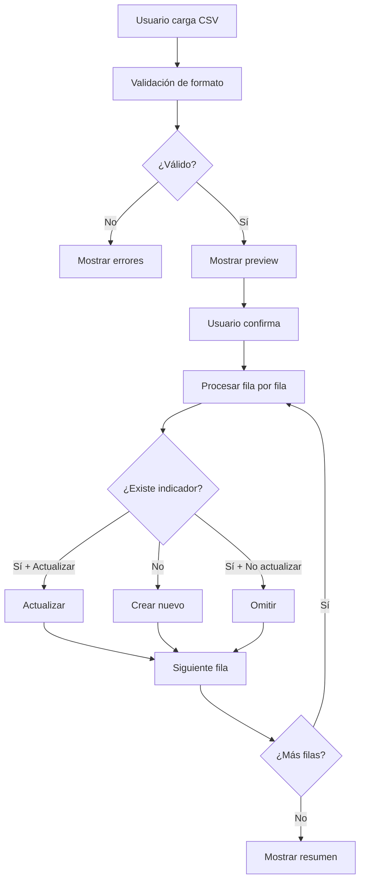

# 📥 Sistema de Importación Masiva de Indicadores

## 🎯 Objetivo

Permitir la creación de múltiples indicadores simultáneamente mediante la carga de un archivo CSV, facilitando la migración de datos y la carga inicial del sistema.

---

## 🚀 Cómo Usar

### **Paso 1: Preparar el Archivo CSV**

Crea un archivo CSV con las siguientes columnas:

#### **Columnas Requeridas:**
- `nombre` - Nombre del indicador
- `subtema` - ID o nombre del subtema al que pertenece

#### **Columnas Opcionales:**
- `descripcion` - Descripción breve
- `definicion_operacional` - Definición técnica
- `unidad_medida` - Ej: "Porcentaje", "Número", "Tasa por 100,000 hab"
- `fuente_datos` - Fuente de información
- `entidad_recopiladora` - Entidad responsable
- `periodicidad` - Ej: "Mensual", "Anual", "Trimestral"
- `fecha_actualizacion` - Formato: YYYY-MM-DD
- `notas` - Notas adicionales
- `operacion` - ID o nombre de la operación estadística
- `activo` - True/False, 1/0, Si/No (default: True)
- `orden` - Número entero para ordenar (default: 0)
- `mostrar_mapa` - True/False, 1/0, Si/No (default: True)
- `dominios_tematicos` - IDs o nombres separados por coma
- `dominios_geograficos` - IDs o nombres separados por coma

---

### **Paso 2: Acceder al Importador**

1. Ve a **Admin → Indicadores**
2. Click en el botón **"📥 Importar CSV"** (azul)

---

### **Paso 3: Cargar el Archivo**

1. Selecciona tu archivo CSV
2. Configura las opciones:
   - ☑️ **Actualizar existentes**: Si un indicador con el mismo nombre ya existe, se actualizará
   - ☐ **Eliminar existentes**: ⚠️ Elimina TODOS los indicadores antes de importar
3. Click en **"📤 Cargar y Previsualizar"**

---

### **Paso 4: Revisar Preview**

El sistema mostrará:
- 📊 **Estadísticas**: Total de filas, columnas detectadas
- 📋 **Columnas**: Lista de todas las columnas encontradas
- 👁️ **Preview**: Primeras 10 filas del CSV
- ⚠️ **Advertencias**: Si hay configuraciones peligrosas

---

### **Paso 5: Confirmar Importación**

1. Revisa los datos
2. Click en **"✅ Confirmar Importación"**
3. El sistema procesará todas las filas
4. Verás un resumen:
   - ✅ Indicadores creados
   - ✏️ Indicadores actualizados
   - ❌ Errores (si los hay)

---

## 📄 Ejemplo de Archivo CSV

```csv
nombre,subtema,descripcion,unidad_medida,activo,orden
"Tasa de Desempleo",1,"Porcentaje de población desempleada","Porcentaje",True,1
"Población Total",2,"Número total de habitantes","Número",True,2
"Índice de Pobreza",3,"Porcentaje de hogares en pobreza","Porcentaje",True,3
```

**Archivo completo:** `docs/ejemplo_importacion_indicadores.csv`

---

## 🔍 Validaciones Automáticas

El sistema valida:

✅ **Formato del archivo**
- Debe ser .csv
- Debe tener columnas requeridas
- No debe estar vacío

✅ **Datos**
- Nombres no pueden estar vacíos
- Subtemas deben existir en la BD
- Fechas deben tener formato correcto
- Valores booleanos deben ser válidos

✅ **Relaciones**
- Operaciones estadísticas deben existir
- Dominios de desagregación deben existir
- Se busca por ID o por nombre (case-insensitive)

---

## 🎨 Características

### **1. Preview Antes de Importar**
- ✅ Muestra las primeras 10 filas
- ✅ Lista todas las columnas detectadas
- ✅ Estadísticas del archivo
- ✅ Advertencias sobre acciones destructivas

### **2. Actualización Inteligente**
- ✅ Detecta indicadores existentes por nombre
- ✅ Opción de actualizar o crear nuevo
- ✅ Preserva relaciones existentes si no se especifican nuevas

### **3. Manejo de Errores Robusto**
- ✅ Transacción atómica (todo o nada)
- ✅ Log detallado de cada fila procesada
- ✅ Continúa procesando aunque haya errores individuales
- ✅ Reporte final con resumen

### **4. Búsqueda Flexible**
- ✅ Busca subtemas por ID o nombre
- ✅ Busca operaciones por ID o nombre
- ✅ Busca dominios por ID o nombre
- ✅ Case-insensitive en búsquedas por nombre

---

## 📊 Flujo de Importación



---

## 🛠️ Arquitectura Técnica

### **Archivos Creados:**

1. **`forms_import.py`**
   - `ImportarIndicadoresForm`: Formulario de carga
   - Validaciones de archivo y formato
   - Verificación de columnas requeridas

2. **`views_import.py`**
   - `importar_indicadores()`: Vista principal
   - `procesar_importacion_indicadores()`: Lógica de procesamiento
   - Manejo de preview y confirmación

3. **`templates/admin/importar_indicadores.html`**
   - Formulario de carga
   - Preview de datos
   - Ayuda contextual
   - Estadísticas visuales

4. **`docs/ejemplo_importacion_indicadores.csv`**
   - Archivo de ejemplo con 5 indicadores
   - Todas las columnas documentadas

---

## 🔐 Seguridad

✅ **Requiere autenticación:** `@staff_member_required`  
✅ **Transacciones atómicas:** Rollback automático si hay error crítico  
✅ **Validación de permisos:** Solo usuarios staff pueden importar  
✅ **Confirmación requerida:** Preview antes de ejecutar  

---

## 📈 Rendimiento

| Cantidad de Indicadores | Tiempo Estimado |
|-------------------------|-----------------|
| 10 indicadores | < 1 segundo |
| 100 indicadores | 2-3 segundos |
| 1,000 indicadores | 15-20 segundos |

**Optimizaciones implementadas:**
- Uso de `bulk_create` donde sea posible
- Queries optimizadas con `select_related`
- Validaciones en memoria antes de BD

---

## 🐛 Solución de Problemas

### **Error: "Subtema no encontrado"**
**Causa:** El nombre o ID del subtema no existe en la BD  
**Solución:** Verifica que los subtemas existan primero o usa IDs exactos

### **Error: "Faltan columnas requeridas"**
**Causa:** El CSV no tiene las columnas `nombre` o `subtema`  
**Solución:** Agrega las columnas requeridas al CSV

### **Error: "Archivo CSV está vacío"**
**Causa:** El archivo no tiene datos o solo tiene encabezados  
**Solución:** Agrega al menos una fila de datos

---

## 📝 Ejemplo Completo

### **Archivo CSV:**
```csv
nombre,subtema,descripcion,unidad_medida,activo,orden,mostrar_mapa
"Tasa de Desempleo","Empleo","Porcentaje de población desempleada","Porcentaje",True,1,True
"Población Total","Demografía","Número total de habitantes","Número",True,2,True
```

### **Resultado:**
```
✅ Importación exitosa!
   Creados: 2
   Actualizados: 0

Log detallado:
✅ Fila 2: Creado "Tasa de Desempleo"
✅ Fila 3: Creado "Población Total"
```

---

## 🔄 Próximos Pasos

Una vez que confirmes que la importación de Indicadores funciona correctamente, implementaremos el sistema similar para **Datos**, que permitirá:

- 📊 Importar miles de registros de datos
- 🔗 Asociar automáticamente a indicadores
- 🏷️ Asignar desagregaciones
- 📅 Validar fechas y valores
- ⚡ Procesamiento en batch para mejor rendimiento

---

## ✅ Estado Actual

**Implementado:** ✅ Importación masiva de Indicadores  
**Pendiente:** ⏳ Importación masiva de Datos  
**Acceso:** `http://localhost:8000/admin/indicadores/indicador/importar/`
