# Diseño del Wizard Admin Unificado - Flujo Dinámico

## 🎯 Objetivo
Wizard adaptativo que cambia sus pasos según el caso de uso detectado.

---

## 📊 Diagrama de Flujo Principal

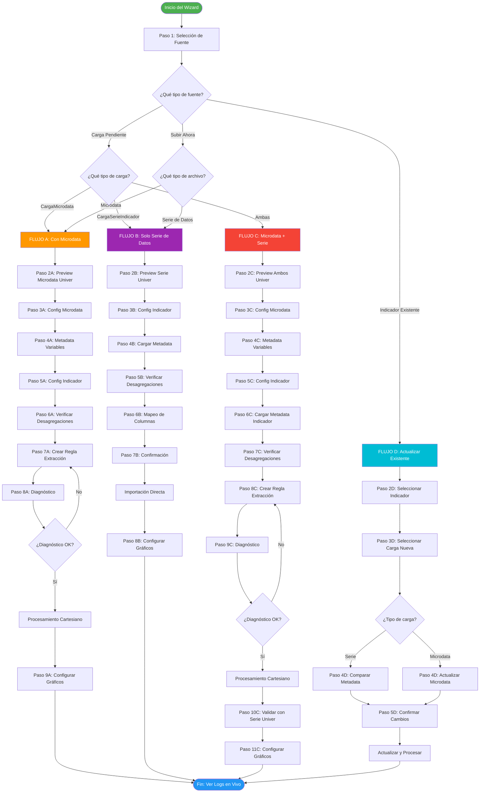

---

## 🔍 Detalle de Cada Paso

### Paso 1: Selección de Fuente (Común a Todos)

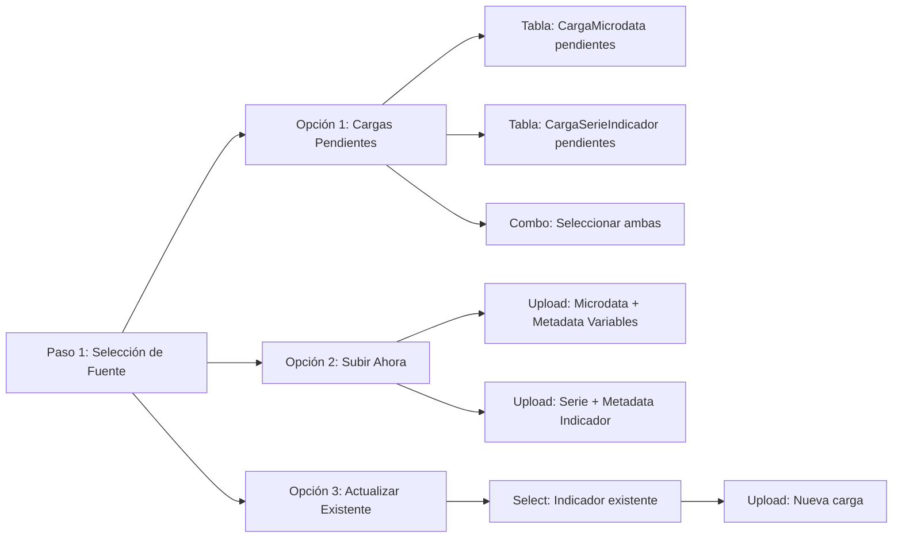

---

## 📋 Pasos del Flujo A (Con Microdata)

```mermaid
flowchart TD
    P2A[Paso 2A: Preview Microdata con Univer]
    P2A --> UNIVER1[Cargar Univer.js dinámicamente]
    P2A --> UNIVER2[Renderizar hoja de cálculo interactiva]
    P2A --> UNIVER3[Mostrar estadísticas: filas, columnas, tamaño]
    P2A --> UNIVER4[Botones: Exportar Excel/CSV]
    
    P3A[Paso 3A: Configurar Microdata]
    P3A --> RADIO1{¿Crear nueva o asociar?}
    RADIO1 -->|Crear| FORM1[Nombre, Descripción, Operación]
    RADIO1 -->|Asociar| SELECT1[Select: Microdata existente]
    
    P4A[Paso 4A: Metadata de Variables]
    P4A --> PARSE[Parsear metadata_variables.csv]
    P4A --> TABLE[Tabla: Variables detectadas]
    P4A --> CHECK[Checkbox: Cargar automáticamente]
    
    P5A[Paso 5A: Configurar Indicador]
    P5A --> RADIO2{¿Crear nuevo o asociar?}
    RADIO2 -->|Crear| FORM2[Código, Nombre, Sigla, Subtema]
    RADIO2 -->|Asociar| SELECT2[Select: Indicador existente]
    P5A --> PARSE2[Parsear metadata.csv si existe]
    P5A --> PREVIEW[Preview: Metadata detectada]
    P5A --> CHECK2[Checkbox: Cargar metadata completa]
    
    P6A[Paso 6A: Verificar Desagregaciones]
    P6A --> ANALIZAR[Analizar columnas del CSV]
    P6A --> DETECTAR[Detectar desagregaciones mencionadas]
    P6A --> COMPARAR[Comparar con BD]
    P6A --> MOSTRAR_GEO[Lista: Geográficas existentes/faltantes]
    P6A --> MOSTRAR_TEM[Lista: Temáticas existentes/faltantes]
    P6A --> SUGERIR[Sugerir dominios para faltantes]
    P6A --> BTN_CREAR[Botón: Crear faltantes automáticamente]
    
    P7A[Paso 7A: Crear Regla de Extracción]
    P7A --> FORM3[Columna fecha]
    P7A --> FORM4[Columnas fuente]
    P7A --> FORM5[Fórmula]
    P7A --> FORM6[Filtros JSON]
    P7A --> FORM7[Orden desagregaciones]
    
    P8A[Paso 8A: Diagnóstico]
    P8A --> EJECUTAR[Ejecutar diagnosticar_microdata]
    P8A --> OUTPUT[Mostrar salida en consola]
    P8A --> VALIDAR{¿Hay errores?}
    VALIDAR -->|Sí| ALERT[Mostrar errores y volver a P7A]
    VALIDAR -->|No| BTN_CONFIRMAR[Botón: Confirmar y Procesar]
```

---

## 📋 Pasos del Flujo B (Solo Serie)

```mermaid
flowchart TD
    P2B[Paso 2B: Preview Serie con Univer]
    P2B --> UNIVER1[Cargar Univer.js dinámicamente]
    P2B --> UNIVER2[Renderizar hoja de cálculo interactiva]
    P2B --> DETECT1[Detectar columnas de desagregación]
    P2B --> DETECT2[Detectar columna de fecha]
    P2B --> DETECT3[Detectar columna de valor]
    P2B --> UNIVER3[Botones: Exportar Excel/CSV]
    
    P3B[Paso 3B: Configurar Indicador]
    P3B --> RADIO{¿Crear nuevo o asociar?}
    RADIO -->|Crear| FORM[Código, Nombre, Sigla, Subtema]
    RADIO -->|Asociar| SELECT[Select: Indicador existente]
    
    P4B[Paso 4B: Cargar Metadata]
    P4B --> PARSE[Parsear metadata.csv]
    P4B --> PREVIEW[Preview: Metadata detectada]
    P4B --> CHECK[Checkbox: Cargar metadata completa]
    P4B --> CAMPOS[Mostrar campos que se cargarán]
    
    P5B[Paso 5B: Verificar Desagregaciones]
    P5B --> ANALIZAR[Analizar valores únicos en columnas]
    P5B --> DETECTAR[Detectar desagregaciones]
    P5B --> COMPARAR[Comparar con BD]
    P5B --> MOSTRAR[Lista: Existentes/Faltantes]
    P5B --> BTN_CREAR[Botón: Crear faltantes]
    
    P6B[Paso 6B: Mapeo de Columnas]
    P6B --> MAP1[Mapear: Columna fecha → fecha_dato]
    P6B --> MAP2[Mapear: Columna valor → valor_dato]
    P6B --> MAP3[Mapear: Columnas desag geo]
    P6B --> MAP4[Mapear: Columnas desag tem]
    P6B --> PREVIEW2[Preview: Cómo se importarán]
    
    P7B[Paso 7B: Confirmación]
    P7B --> RESUMEN[Resumen de configuración]
    P7B --> CHECKBOX[Checkbox: Eliminar datos existentes]
    P7B --> BTN[Botón: Importar Datos]
```

---

## 📋 Pasos del Flujo C (Completo: Microdata + Serie)

**Caso de Uso:** El equipo técnico subió AMBAS cargas:
- `CargaMicrodata` (microdata.csv + metadata_variables.csv)
- `CargaSerieIndicador` (datos.csv + metadata.csv)

**Objetivo:** 
1. Procesar microdata con producto cartesiano
2. Cargar metadata del indicador desde `CargaSerieIndicador`
3. Validar que los datos procesados coincidan con la serie original

### Uso de Archivos en Flujo C

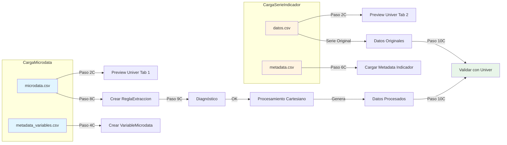

```mermaid
flowchart TD
    P2C[Paso 2C: Preview Ambos con Univer]
    P2C --> TABS[Tabs: Microdata | Serie]
    P2C --> TAB1[Tab Microdata: Univer con microdata]
    P2C --> TAB2[Tab Serie: Univer con serie]
    P2C --> STATS[Estadísticas de ambos archivos]
    
    P3C[Paso 3C: Config Microdata]
    P3C --> IGUAL_3C[Igual que Paso 3A del Flujo A]
    
    P4C[Paso 4C: Metadata Variables]
    P4C --> PARSE_VAR[Parsear metadata_variables.csv]
    P4C --> TABLA_VAR[Tabla: Variables detectadas]
    P4C --> CHECK_VAR[Checkbox: Cargar automáticamente]
    
    P5C[Paso 5C: Config Indicador]
    P5C --> RADIO{¿Crear nuevo o asociar?}
    RADIO -->|Crear| FORM[Código, Nombre, Sigla, Subtema]
    RADIO -->|Asociar| SELECT[Select: Indicador existente]
    
    P6C[Paso 6C: Cargar Metadata Indicador]
    P6C --> PARSE_IND[Parsear metadata.csv de CargaSerieIndicador]
    P6C --> PREVIEW_IND[Preview: Metadata detectada]
    P6C --> CAMPOS_IND[Mostrar todos los campos de ficha técnica]
    P6C --> CHECK_IND[Checkbox: Cargar metadata completa]
    P6C --> INFO_IND[Info: Datos vienen de CargaSerieIndicador]
    
    P7C[Paso 7C: Verificar Desagregaciones]
    P7C --> ANALIZAR[Analizar columnas de microdata Y serie]
    P7C --> DETECTAR[Detectar desagregaciones en ambos]
    P7C --> COMPARAR[Comparar con BD]
    P7C --> MOSTRAR[Lista: Existentes/Faltantes]
    P7C --> BTN_CREAR[Botón: Crear faltantes]
    
    P8C[Paso 8C: Crear Regla Extracción]
    P8C --> IGUAL_8C[Igual que Paso 7A del Flujo A]
    
    P9C[Paso 9C: Diagnóstico]
    P9C --> IGUAL_9C[Igual que Paso 8A del Flujo A]
    
    P10C[Paso 10C: Validar con Serie Univer]
    P10C --> TABS2[Tabs: Datos Procesados | Serie Original]
    P10C --> TAB3[Tab 1: Univer con datos procesados]
    P10C --> TAB4[Tab 2: Univer con serie original]
    P10C --> INFO[Info: Comparar visualmente a ojo]
    P10C --> NOTA[Nota: No hay comparación automática]
    P10C --> AYUDA[Ayuda: Verificar que fórmula sea correcta]
    
    P11C[Paso 11C: Configurar Gráficos]
    P11C --> IGUAL2[Ver sección de Gráficos abajo]
```

---

## 📋 Pasos del Flujo D (Actualizar Existente)

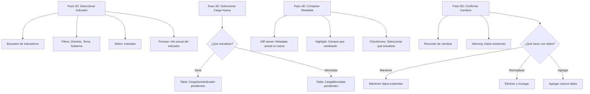

---

## 🎨 Componentes Visuales Clave

### Selector de Cargas Pendientes

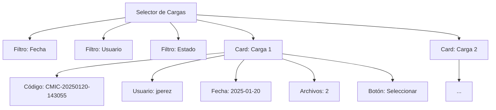

### Verificador de Desagregaciones

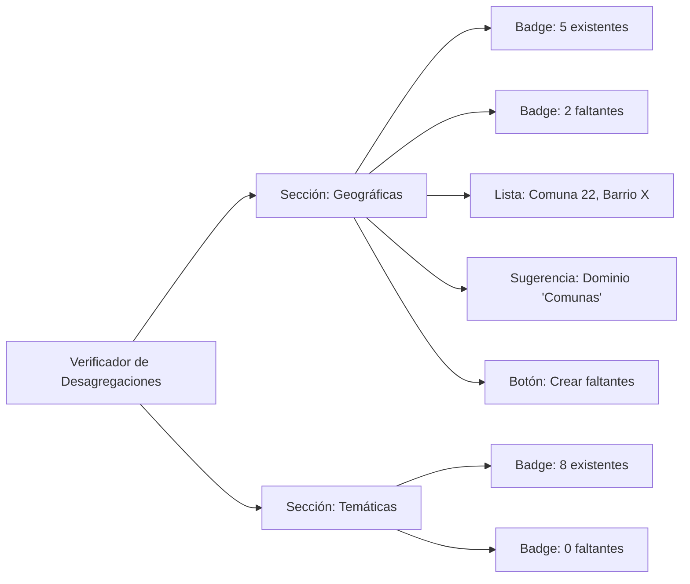

---

## 🔄 Navegación Entre Pasos

```mermaid
stateDiagram-v2
    [*] --> Paso1
    Paso1 --> Paso2A: Flujo A
    Paso1 --> Paso2B: Flujo B
    Paso1 --> Paso2C: Flujo C
    Paso1 --> Paso2D: Flujo D
    
    Paso2A --> Paso3A: Siguiente
    Paso3A --> Paso2A: Anterior
    Paso3A --> Paso4A: Siguiente
    Paso4A --> Paso3A: Anterior
    
    note right of Paso1
        Siempre se puede:
        - Ir al paso anterior
        - Cancelar wizard
        - Ver resumen parcial
    end note
    
    note right of Paso8A
        Diagnóstico puede:
        - Volver a P7A si hay errores
        - Continuar si todo OK
    end note
```

---

## 📊 Estado del Wizard (Session Data)

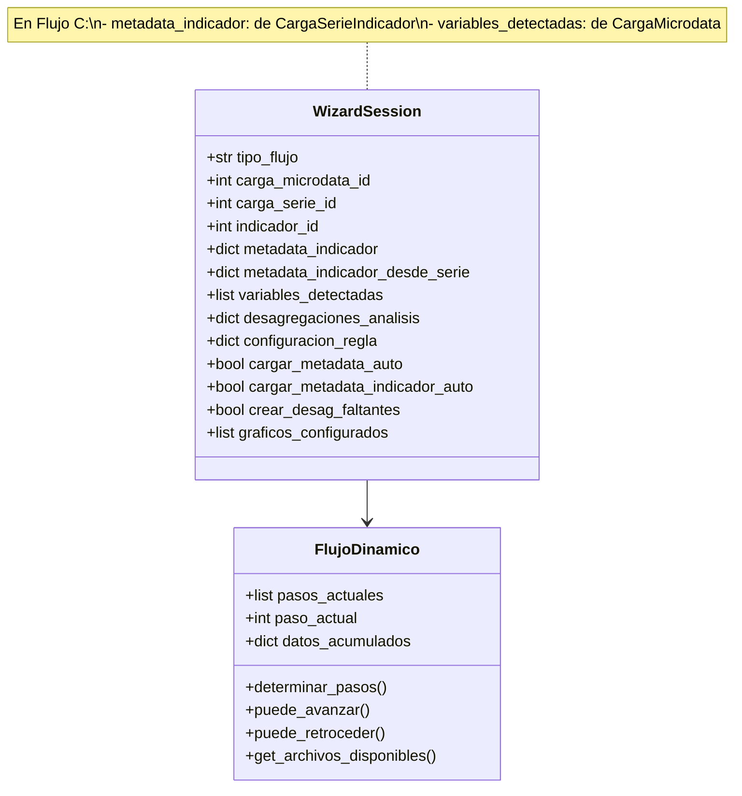

---

## 🎯 Decisiones de Diseño

### 1. ¿Por qué pasos dinámicos?
- **Flexibilidad:** Se adapta al caso de uso real
- **Simplicidad:** Usuario solo ve pasos relevantes
- **Eficiencia:** No pierde tiempo en pasos innecesarios

### 2. ¿Por qué separar flujos?
- **Claridad:** Cada flujo tiene su lógica específica
- **Mantenibilidad:** Más fácil modificar un flujo sin afectar otros
- **Testing:** Se puede probar cada flujo independientemente

### 3. ¿Por qué validar desagregaciones?
- **Prevención:** Evita errores en procesamiento
- **Automatización:** Crea elementos faltantes automáticamente
- **Transparencia:** Usuario ve qué falta antes de procesar

---

## 📊 Detalle: Integración de Univer.js

### ¿Qué es Univer?
**Univer** (https://univer.ai/) es una librería JavaScript de código abierto que renderiza hojas de cálculo tipo Excel en el navegador con funcionalidades completas.

### Características que usaremos:
- ✅ Renderizado de datos CSV como hoja de cálculo interactiva
- ✅ Scroll, zoom, navegación con teclado
- ✅ Edición de celdas (opcional, solo para exploración)
- ✅ Fórmulas básicas (SUM, AVERAGE, COUNT)
- ✅ Exportación a Excel y CSV
- ✅ Formato visual (colores, negrita, alineación)
- ✅ Redimensionamiento de filas y columnas

### Implementación en el Wizard

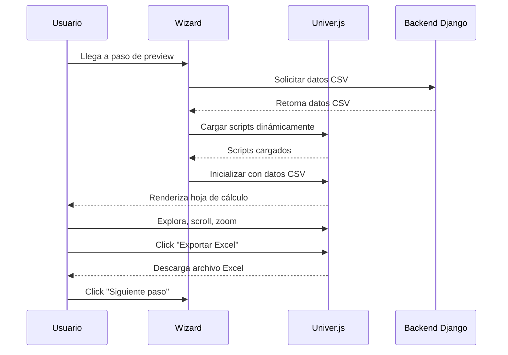

### Código de Integración (Ejemplo)

```javascript
// Cargar Univer dinámicamente
async function loadUniver() {
    const scripts = [
        'https://unpkg.com/@univerjs/presets/lib/umd/index.js',
        'https://unpkg.com/@univerjs/preset-sheets-core/lib/umd/index.js'
    ];
    
    for (const src of scripts) {
        await loadScript(src);
    }
}

// Inicializar Univer con datos CSV
function initUniver(csvData) {
    const { createUniver } = window.UniverPresets;
    
    const univer = createUniver({
        locale: 'en-US',
        container: 'univer-container',
        data: parseCSVToUniverFormat(csvData)
    });
    
    return univer;
}

// Exportar a Excel
function exportToExcel(univerInstance) {
    const data = univerInstance.getSheetData();
    const worksheet = XLSX.utils.aoa_to_sheet(data);
    const workbook = XLSX.utils.book_new();
    XLSX.utils.book_append_sheet(workbook, worksheet, 'Datos');
    XLSX.writeFile(workbook, 'datos.xlsx');
}
```

---

## 🎨 Detalle: Configuración de Gráficos

### Paso Final: Configurar Gráficos (Todos los Flujos)

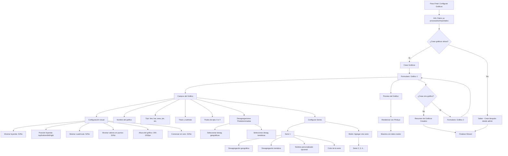

### Modelo de Datos de Gráficos

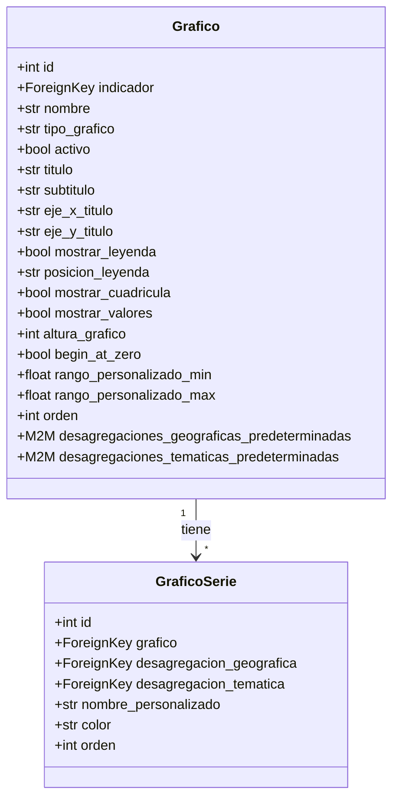

### Formulario de Gráfico en el Wizard

```python
class FormularioGrafico(forms.Form):
    """Formulario para crear un gráfico en el wizard"""
    
    # Básico
    nombre = forms.CharField(max_length=255, label="Nombre del Gráfico")
    tipo_grafico = forms.ChoiceField(
        choices=Grafico.TIPO_GRAFICO_CHOICES,
        label="Tipo de Gráfico"
    )
    activo = forms.BooleanField(initial=True, required=False)
    
    # Títulos
    titulo = forms.CharField(max_length=255, required=False)
    subtitulo = forms.CharField(max_length=255, required=False)
    eje_x_titulo = forms.CharField(max_length=255, required=False)
    eje_y_titulo = forms.CharField(max_length=255, required=False)
    
    # Configuración visual
    mostrar_leyenda = forms.BooleanField(initial=True, required=False)
    posicion_leyenda = forms.ChoiceField(
        choices=Grafico.POSICION_LEYENDA_CHOICES,
        initial='right'
    )
    mostrar_cuadricula = forms.BooleanField(initial=True, required=False)
    mostrar_valores = forms.BooleanField(initial=False, required=False)
    altura_grafico = forms.IntegerField(
        initial=400,
        min_value=200,
        max_value=1000
    )
    begin_at_zero = forms.BooleanField(initial=True, required=False)
    
    # Desagregaciones predeterminadas
    desagregaciones_geograficas = forms.ModelMultipleChoiceField(
        queryset=Desagregacion.objects.none(),
        required=False,
        widget=forms.CheckboxSelectMultiple
    )
    desagregaciones_tematicas = forms.ModelMultipleChoiceField(
        queryset=Desagregacion.objects.none(),
        required=False,
        widget=forms.CheckboxSelectMultiple
    )
    
    def __init__(self, *args, **kwargs):
        indicador = kwargs.pop('indicador', None)
        super().__init__(*args, **kwargs)
        
        if indicador:
            # Filtrar desagregaciones según dominios del indicador
            self.fields['desagregaciones_geograficas'].queryset = \
                Desagregacion.objects.filter(
                    dominio__in=indicador.dominios_desagregacion_geografica.all()
                )
            self.fields['desagregaciones_tematicas'].queryset = \
                Desagregacion.objects.filter(
                    dominio__in=indicador.dominios_desagregacion_tematica.all()
                )
```

### Formset para Series del Gráfico

```python
from django.forms import formset_factory

class FormularioSerie(forms.Form):
    """Formulario para una serie del gráfico"""
    
    desagregacion_geografica = forms.ModelChoiceField(
        queryset=Desagregacion.objects.none(),
        required=False
    )
    desagregacion_tematica = forms.ModelChoiceField(
        queryset=Desagregacion.objects.none(),
        required=False
    )
    nombre_personalizado = forms.CharField(
        max_length=255,
        required=False,
        help_text="Opcional: nombre personalizado para la serie"
    )
    color = forms.CharField(
        max_length=50,
        required=False,
        widget=forms.TextInput(attrs={'type': 'color'})
    )
    orden = forms.IntegerField(initial=0, widget=forms.HiddenInput())

# Crear formset con mínimo 1 serie, máximo 10
SerieFormSet = formset_factory(
    FormularioSerie,
    extra=1,
    min_num=1,
    max_num=10,
    validate_min=True
)
```

### Vista del Paso de Gráficos

```html
<div class="wizard-step graficos">
    <h2>Configurar Gráficos para el Indicador</h2>
    
    <div class="info-box">
        <i class="fas fa-info-circle"></i>
        <p>Los gráficos son opcionales. Puedes crearlos ahora o más tarde desde el admin.</p>
    </div>
    
    <div class="graficos-container">
        <!-- Formulario del gráfico -->
        <div class="grafico-form">
            <h3>Gráfico 1</h3>
            
            {{ form.nombre }}
            {{ form.tipo_grafico }}
            
            <div class="form-section">
                <h4>Títulos</h4>
                {{ form.titulo }}
                {{ form.subtitulo }}
                {{ form.eje_x_titulo }}
                {{ form.eje_y_titulo }}
            </div>
            
            <div class="form-section">
                <h4>Configuración Visual</h4>
                <div class="form-row">
                    {{ form.mostrar_leyenda }}
                    {{ form.posicion_leyenda }}
                </div>
                <div class="form-row">
                    {{ form.mostrar_cuadricula }}
                    {{ form.mostrar_valores }}
                </div>
                {{ form.altura_grafico }}
                {{ form.begin_at_zero }}
            </div>
            
            <div class="form-section">
                <h4>Desagregaciones Predeterminadas</h4>
                <div class="desag-columns">
                    <div class="desag-geo">
                        <h5>Geográficas</h5>
                        {{ form.desagregaciones_geograficas }}
                    </div>
                    <div class="desag-tem">
                        <h5>Temáticas</h5>
                        {{ form.desagregaciones_tematicas }}
                    </div>
                </div>
            </div>
            
            <div class="form-section">
                <h4>Series del Gráfico</h4>
                <div id="series-formset">
                    {{ serie_formset.management_form }}
                    
                    <div class="serie-form">
                        <h5>Serie {{ forloop.counter }}</h5>
                        {{ serie_form.desagregacion_geografica }}
                        {{ serie_form.desagregacion_tematica }}
                        {{ serie_form.nombre_personalizado }}
                        {{ serie_form.color }}
                        {{ serie_form.orden }}
                    </div>
                    
                </div>
                <button type="button" id="add-serie">
                    <i class="fas fa-plus"></i> Agregar Serie
                </button>
            </div>
        </div>
        
        <!-- Preview del gráfico -->
        <div class="grafico-preview">
            <h3>Vista Previa</h3>
            <div id="preview-chart"></div>
            <p class="text-muted">El gráfico se actualizará al cambiar opciones</p>
        </div>
    </div>
    
    <div class="wizard-actions">
        <button type="button" class="btn-secondary" id="skip-graficos">
            Saltar - Crear Después
        </button>
        <button type="button" class="btn-primary" id="add-otro-grafico">
            <i class="fas fa-plus"></i> Crear Otro Gráfico
        </button>
        <button type="submit" class="btn-success">
            <i class="fas fa-check"></i> Finalizar
        </button>
    </div>
</div>
```

---

## 🚀 Próximos Pasos

Una vez aprobado este diseño:
1. Implementar clase `WizardAdminUnificado`
2. Crear formularios para cada paso
3. Implementar lógica de pasos dinámicos
4. Integrar Univer.js en pasos de preview
5. Crear formularios y formsets de gráficos
6. Crear templates con componentes visuales
7. Integrar con procesamiento normalizado (Fase 1)

---

**Estado:** 🎨 Diseño en Revisión  
**Fecha:** 2025-01-20  
**Actualizado:** Agregado Univer.js y Gráficos  
**Pendiente:** Aprobación y ajustes del usuario
